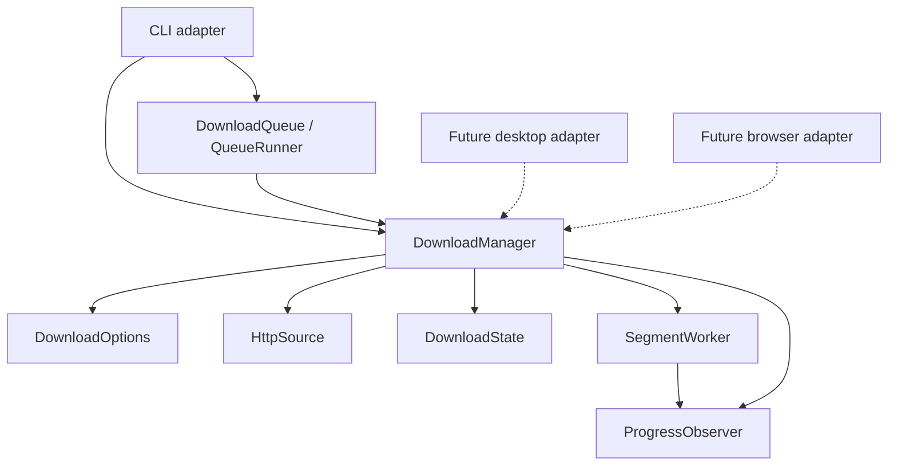

# Architecture

RustDM uses composition and ownership to separate application logic from its
interfaces. Structs encapsulate state and expose methods; a trait expresses the
progress interface that a CLI, desktop view, or browser adapter can implement.

## Workspace boundaries

`crates/core` builds the `rustdm-core` library. `apps/cli` builds the `rustdm`
executable and depends on that library. The root manifest owns dependency
versions, package metadata, lints, and release settings. Cargo.lock and target
are shared across packages.

`apps/ui`, `apps/web`, and `extensions/browser` currently contain design notes,
not workspace packages or runnable interfaces. They will be added to the workspace
when their milestones begin.



| Module | Responsibility |
|---|---|
| `crates/core/src/domain.rs` | Options, progress/results, resource identity, and range planning |
| `crates/core/src/manager.rs` | Application service: validation, transfer orchestration, and completion |
| `crates/core/src/http.rs` | HTTP configuration, probing, and response-header validation |
| `crates/core/src/state.rs` | Manifest, exclusive lock, assembly, and publication |
| `crates/core/src/transfer.rs` | Range workers and single-stream transfer |
| `crates/core/src/bandwidth.rs` | Shared response-body pacing and cancellable waits |
| `crates/core/src/metrics.rs` | Recent transfer speed and ETA measurement |
| `crates/core/src/queue/model.rs` | Job states, snapshots, attempts, events, and run results |
| `crates/core/src/queue/store.rs` | Atomic queue transactions, locks, history, and recovery |
| `crates/core/src/queue/runner.rs` | Sequential queued-job orchestration through DownloadManager |
| `apps/cli/src/args.rs` | Arguments, legacy syntax, and command definitions |
| `apps/cli/src/execution.rs` | Ctrl+C, queued/direct execution, and progress events |
| `apps/cli/src/main.rs` | Command dispatch, tabular/JSON results, and exit behavior |
| `apps/cli/src/progress.rs` | Terminal rendering and update throttling |
| `crates/core/src/lib.rs` | Small public API and convenience entry point |

## Test organization

All test source files live under repository-root [`tests/`](../tests/README.md).
Core suites are grouped under `tests/core` (including `queue/`); CLI parsing and
HTTP/process suites live under `tests/cli`. The `ui`, `web`, and `browser` test
folders are reserved for later milestones. Test-only module paths preserve unit
test access to private implementation details. An explicit CLI Cargo test target
registers the HTTP/process suite. Workspace test, format, and lint commands cover
these files without making internal methods public.

## Public API

`DownloadOptions` has private external fields and builder-style methods.
`DownloadManager` owns its options and composes the concrete HTTP/state services.
`ProgressObserver` is the extension point for presentation; closures implement
it automatically. A cancellation token is shared with active transfers.

```rust,no_run
use rustdm_core::{CancellationToken, DownloadManager, DownloadOptions, Progress};

# async fn example() -> anyhow::Result<()> {
let options = DownloadOptions::new("https://example.com/archive.zip", "archive.zip")
    .with_connections(4)
    .with_retries(3);
let manager = DownloadManager::new(options);
let result = manager.download(CancellationToken::new(), |progress: Progress| {
    println!("{} bytes", progress.downloaded);
}).await?;
println!("Saved {} bytes", result.bytes);
# Ok(())
# }
```

There is no inheritance hierarchy or separate engine per interface. Transport
and storage traits can be introduced when a second implementation needs them;
the current concrete components are exercised through real HTTP behavior tests.

## Download lifecycle

1. Validate options and acquire the output's writer lock.
2. Probe a one-byte range with identity encoding; inspect size and validator.
3. Create or validate the saved manifest. Parallel/resumed transfers require
   ranges and a strong ETag or Last-Modified validator.
4. Transfer non-overlapping segments into separate files, retrying missing bytes.
   Otherwise download a single stream, restarting that stream on retry.
5. Verify sizes, assemble into a temporary file, sync it, and publish without
   replacing an existing destination.
6. Remove only known sidecar files after successful publication.

Dropping `DownloadState` releases its OS file lock, including on errors. Failed
range transfers retain their data; a subsequent manager validates resource
identity before reuse. Progress callbacks may run concurrently and must be
thread-safe. Interface adapters should enqueue events rather than block workers.

`ProgressMeter` measures received-byte deltas over elapsed time and returns a
`TransferMetrics` snapshot. The initial resumed byte count is a baseline, not
new network traffic. Zero elapsed time, stream counter resets, unknown size,
and zero speed produce explicit unknown estimates instead of invented rates.
The CLI uses a watch channel to retain the newest sample, then renders at a
bounded frequency. Other interfaces can use the same meter with their own view.

The manifest stores URLs, size, validators, and segment layout. Request headers
are supplied in memory and must be supplied again for authenticated resume.
Static segments and some blocking local file I/O remain deliberate initial
constraints; further performance work belongs to the CLI milestone.

## Bandwidth pacing

`DownloadOptions::with_bandwidth_limit(bytes_per_second)` sets an optional positive
aggregate byte rate; `bandwidth_limit()` reads it. The manager validates zero
before acquiring output state, then creates one `Arc<BandwidthLimiter>` per
execution. Range workers and single-stream retries use this same instance.

The limiter serializes byte budgets through an async mutex and cancellable timer.
Body chunks are split into slices of at most 16 KiB (smaller at low rates), then
paced before writing and reporting progress. Idle time does not accumulate burst
credit. Existing resume bytes bypass the limiter. Timer granularity, server speed,
and local I/O can lower throughput; this limits consumed body data rather than
exact wire traffic, HTTP headers, probing, or transport buffering. Independent
manager executions have independent budgets. Queued jobs persist the optional
rate and restore it through their normal options builder.

## Persistent queue

`DownloadQueue` owns a canonical state-directory path. Its short OS-locked
transactions validate and atomically replace a versioned JSON snapshot.
`QueueJob` exposes read-only getters and serializable snapshots. `QueueRunner`
holds an independent exclusive session lock and composes `DownloadManager` for
each job. Its mutable execution method prevents concurrent use of one runner.

Running attempts are saved before network execution and terminal results afterward.
The session lock allows a replacement runner to recognize and record abandoned
attempts. Failed jobs do not block later jobs, cancellation stops before claiming
the next job, and every retry appends history. Job-level progress events let each
adapter reset its progress meter without putting terminal behavior in the core.
See [queue semantics](QUEUE.md) for persistence and recovery boundaries.
