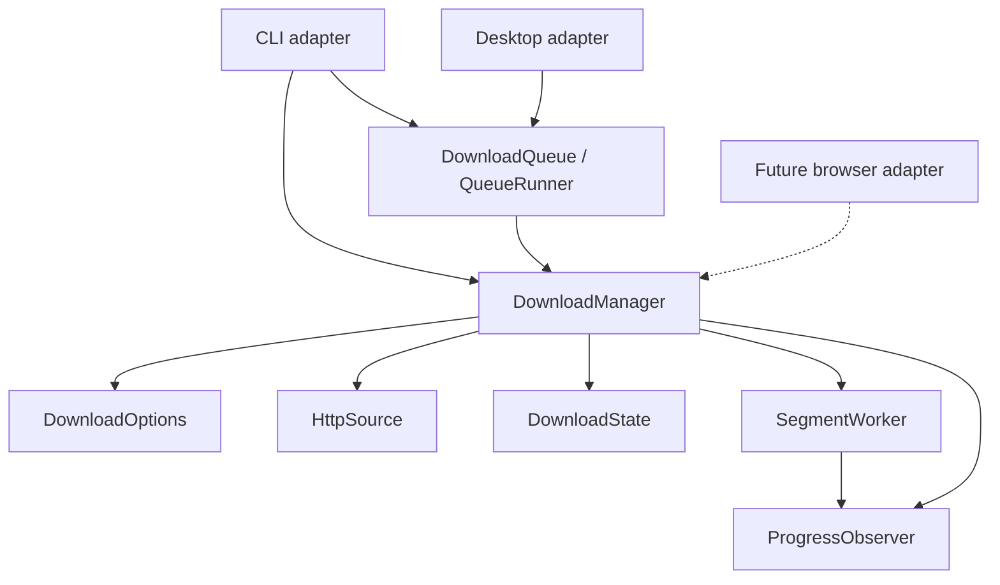

# Architecture

RustDM uses composition and ownership to separate application logic from its
interfaces. Structs encapsulate state and expose methods; a trait expresses the
progress interface that a CLI, desktop view, or browser adapter can implement.

## Workspace boundaries

`crates/core` builds the `rustdm-core` library. `apps/cli` builds the `rustdm`
executable and depends on that library. The root manifest owns dependency
versions, package metadata, lints, and release settings. Cargo.lock and target
are shared across packages.

`apps/ui` builds the `rustdm-ui` native egui/eframe application. It composes
`DownloadQueue` and `QueueRunner` from the same core. `apps/web` and
`extensions/browser` remain design notes for later milestones.



| Module | Responsibility |
|---|---|
| `crates/core/src/domain.rs` | Options, progress/results, resource identity, and range planning |
| `crates/core/src/manager.rs` | Application service: validation, transfer orchestration, and completion |
| `crates/core/src/http.rs` | HTTP configuration, probing, and response-header validation |
| `crates/core/src/state.rs` | Manifest, exclusive lock, assembly, and publication |
| `crates/core/src/transfer.rs` | Range workers and single-stream transfer |
| `crates/core/src/checksum.rs` | Validated SHA-256 value and incremental assembly verification |
| `crates/core/src/bandwidth.rs` | Shared response-body pacing and cancellable waits |
| `crates/core/src/metrics.rs` | Recent transfer speed and ETA measurement |
| `crates/core/src/queue/model.rs` | Job states, snapshots, attempts, events, and run results |
| `crates/core/src/queue/store.rs` | Atomic queue transactions, locks, history, and recovery |
| `crates/core/src/queue/runner.rs` | Sequential queued-job orchestration through DownloadManager |
| `apps/cli/src/args.rs` | Arguments, legacy syntax, and command definitions |
| `apps/cli/src/execution.rs` | Ctrl+C, queued/direct execution, and progress events |
| `apps/cli/src/main.rs` | Command dispatch, tabular/JSON results, and exit behavior |
| `apps/cli/src/progress.rs` | Terminal rendering and update throttling |
| `crates/core/src/lib.rs` | Small public API and convenience entry point |

## Desktop adapter

`apps/ui/src/app.rs` renders the dashboard, filter/search views, history, and
add-download dialog. `model.rs` validates form values without owning transfers;
`theme.rs` contains the native dark theme. `backend.rs` owns a two-worker Tokio
runtime, a persistent queue, and a single cancellation session. Queue/storage
operations and native file dialogs execute on background blocking workers.

Progress is coalesced through a watch channel. Durable lifecycle messages use a
separate channel; snapshots refresh at transitions and periodically to pick up
changes made by another interface. The core runner lock serializes CLI/desktop
executors. Closing the window requests cancellation and defers closure until the
runner has stopped, preserving the existing recovery behavior. The desktop
shares the core's single active queue job and does not introduce a new engine.

## Connection telemetry

`ProgressObserver::on_connection(ConnectionProgress)` is an optional callback;
existing progress closures keep working. `ConnectionReporter` owns one-based
worker IDs and new-byte counters for an execution. Range workers emit request,
receive, and retry states, and the manager emits terminal states after each
worker exits. IDs/counters persist across dynamically assigned ranges. The
single-stream path uses the same reporting contract, including retry/backoff
cancellation. Resume bytes remain solely in aggregate progress.

`QueueObserver` bridges this into `QueueEvent::Connection`. Consumers matching
queue events must handle the new variant; the CLI ignores it. The desktop
coalesces a bounded set of worker rows in a separate watch channel and sends a
final snapshot through the lifecycle channel before changing jobs, so a fast
queue transition does not lose the previous job's final rows. Telemetry is not
stored in queue JSON. Connection completion describes the body transfer and does
not bypass the job's final checksum or publication checks.

## Test organization

All test source files live under repository-root [`tests/`](../tests/README.md).
Core suites are grouped under `tests/core` (including `queue/`); CLI parsing and
HTTP/process suites live under `tests/cli`. Desktop form/backend suites live
under `tests/ui`; `web` and `browser` test folders are reserved for later milestones. Test-only module paths preserve unit
test access to private implementation details. An explicit CLI Cargo test target
registers the HTTP/process suite. Workspace test, format, and lint commands cover
these files without making internal methods public.

## Public API

`DownloadOptions` has private external fields and builder-style methods.
`DownloadManager` owns its options and composes the concrete HTTP/state services.
`ProgressObserver` is the extension point for presentation; closures implement
it automatically. A cancellation token is shared with active transfers.

```rust,no_run
use rustdm_core::{CancellationToken, DownloadManager, DownloadOptions, Progress};

# async fn example() -> anyhow::Result<()> {
let options = DownloadOptions::new("https://example.com/archive.zip", "archive.zip")
    .with_connections(4)
    .with_retries(3);
let manager = DownloadManager::new(options);
let result = manager.download(CancellationToken::new(), |progress: Progress| {
    println!("{} bytes", progress.downloaded);
}).await?;
println!("Saved {} bytes", result.bytes);
# Ok(())
# }
```

There is no inheritance hierarchy or separate engine per interface. Transport
and storage traits can be introduced when a second implementation needs them;
the current concrete components are exercised through real HTTP behavior tests.

## Download lifecycle

1. Validate options and acquire the output's writer lock.
2. Probe a one-byte range with identity encoding; inspect size and validator.
3. Create or validate the saved manifest. Parallel/resumed transfers require
   ranges and a strong ETag or Last-Modified validator.
4. Dispatch non-overlapping saved segments to a bounded pool of workers,
   transferring into separate files and retrying missing bytes.
   Otherwise download a single stream, restarting that stream on retry.
5. Verify sizes, assemble into a temporary file, verify any expected SHA-256,
   sync it, and publish without
   replacing an existing destination.
6. Remove only known sidecar files after successful publication.

Dropping `DownloadState` releases its OS file lock, including on errors. Failed
range transfers retain their data; a subsequent manager validates resource
identity before reuse. Progress callbacks may run concurrently and must be
thread-safe. Interface adapters should enqueue events rather than block workers.

`ProgressMeter` measures received-byte deltas over elapsed time and returns a
`TransferMetrics` snapshot. The initial resumed byte count is a baseline, not
new network traffic. Zero elapsed time, stream counter resets, unknown size,
and zero speed produce explicit unknown estimates instead of invented rates.
The CLI uses a watch channel to retain the newest sample, then renders at a
bounded frequency. Other interfaces can use the same meter with their own view.

The manifest stores URLs, size, validators, and segment layout. Request headers
are supplied in memory and must be supplied again for authenticated resume.
Range boundaries remain fixed during an execution; some local file I/O is still
blocking. Further performance work belongs to the CLI milestone.

## Dynamic range scheduling

For large files, `Segment::plan` creates up to eight ranges per configured
connection, bounded by 128 total saved parts. A 256 KiB planning threshold avoids
making extra tiny ranges; small files retain approximately one range per
connection. The parts partition the full byte interval without gaps or overlaps,
including at the largest representable file size.

The manager starts at most `--connections` tasks. Each claims a unique index
from an atomic counter, runs the existing `SegmentWorker` with its per-part retry
budget, and then claims the next index. A slow request therefore does not prevent
other workers from processing pending parts. Every worker shares cancellation,
progress counters, and the bandwidth limiter. The manager joins the whole pool
before assembly or error return, retaining the output lock during worker cleanup.

Part paths, boundaries, and assembly order remain stable. Completed parts are
skipped on resume; pending parts use the new execution's connection limit even
when the saved plan was created with a larger limit. `DownloadSummary.connections`
reports the worker limit for that execution, rather than the number of saved
parts. Older manifests with up to 16 parts remain valid. New manifests keep the
same format but may contain up to 128 parts; old builds reject larger plans.
Splitting an already active slow range remains future work, so the last remaining
range can still be a bottleneck.

## Bandwidth pacing

`DownloadOptions::with_bandwidth_limit(bytes_per_second)` sets an optional positive
aggregate byte rate; `bandwidth_limit()` reads it. The manager validates zero
before acquiring output state, then creates one `Arc<BandwidthLimiter>` per
execution. Range workers and single-stream retries use this same instance.

The limiter serializes byte budgets through an async mutex and cancellable timer.
Body chunks are split into slices of at most 16 KiB (smaller at low rates), then
paced before writing and reporting progress. Idle time does not accumulate burst
credit. Existing resume bytes bypass the limiter. Timer granularity, server speed,
and local I/O can lower throughput; this limits consumed body data rather than
exact wire traffic, HTTP headers, probing, or transport buffering. Independent
manager executions have independent budgets. Queued jobs persist the optional
rate and restore it through their normal options builder.

## Checksum verification

`Sha256Checksum` is a validated value object parsed from exactly 64 hexadecimal
characters and normalized to lowercase. Its `FromStr` and Serde implementations
share validation, so CLI arguments and persisted queue data follow the same
contract. `DownloadOptions::with_sha256(checksum)` configures verification;
`sha256()` reads the optional expectation.

The state publisher streams each assembled buffer through `ChecksumVerifier`
using ring's SHA-256 implementation (also already present through the TLS stack).
Hashing shares the assembly pass, uses bounded memory, and covers saved and newly
received bytes in final-file order. Before the no-clobber publication step, it
compares the digest and checks cancellation. A mismatch drops the temporary
assembly and retains the original parts; it never produces a successful summary.

Direct-download expectations belong to each invocation and must be supplied again
on resume; they are not part of the existing partial manifest. Queue snapshots
persist `sha256` as an optional validated string and restore it on every attempt.
Older records without it keep checksum verification disabled. Corrupt saved
digests fail deserialization without rewriting the queue. Automatic deletion or
redownload of checksum-mismatched parts is deliberately left to a future recovery
workflow; a new output path starts a fresh download.

## Persistent queue

`DownloadQueue` owns a canonical state-directory path. Its short OS-locked
transactions validate and atomically replace a versioned JSON snapshot.
`QueueJob` exposes read-only getters and serializable snapshots. `QueueRunner`
holds an independent exclusive session lock and composes `DownloadManager` for
each job. Its mutable execution method prevents concurrent use of one runner.

Running attempts are saved before network execution and terminal results afterward.
The session lock allows a replacement runner to recognize and record abandoned
attempts. Failed jobs do not block later jobs, cancellation stops before claiming
the next job, and every retry appends history. Job-level progress events let each
adapter reset its progress meter without putting terminal behavior in the core.
See [queue semantics](QUEUE.md) for persistence and recovery boundaries.

## Desktop system tray

The UI's `tray` adapter owns a native Windows [tray-icon](https://docs.rs/tray-icon/0.26.1/tray_icon/) handle and menu on the
GUI thread. Native callbacks send typed actions and request an egui repaint to
wake eframe. Download tasks still belong to the existing backend runtime.
`App::logic` polls lifecycle/progress and handles tray actions even while the
window is hidden; `App::ui` owns visible controls and window-close input.

The close-to-tray preference is opt-in. Hiding requires an available tray and no
open destination picker; Quit bypasses that preference and uses the normal
cancellation/drain path. Native creation failures report a warning, and unsupported
platforms return no tray adapter, preserving normal safe-close semantics. Menu
availability and tooltips track queue/shutdown state. The icon and menu drop when
the desktop app exits; there is no separate tray daemon.

## Desktop preferences and shutdown

The desktop's `preferences` module owns a versioned, validated settings snapshot
separate from the core queue. `PreferencesStore` serializes atomic replacements
under a dedicated OS lock; a save first validates the existing format to preserve
corrupt or newer files. `settings` owns draft edits and commits them only on Save.
Saved transfer defaults construct new download forms without changing existing
jobs, and the initial folder is passed to the background native file picker.

Quitting cancels transfers and waits for pending enqueue/file-picker replies.
Controls are disabled while closing, and enqueue replies cannot restart the queue
during shutdown. Finished session handles are reaped so task panics become visible
error events; startup failures use a native error dialog. Transfer and persistence
semantics remain in the shared core.

## Browser adapter

`extensions/browser/native-host` is a separate Rust application adapter.
`framing` owns bounded native-endian stdin/stdout messages, and `host` validates
configuration, callers, schema, and destination basenames before composing the
shared `DownloadQueue`. It does not launch a transfer engine or accept browser
filesystem paths. The host only enqueues jobs, keeping the core independent of
browser APIs and registration.

The extension separates protocol validation, browser transport/session drafts,
background link selection, and the review form. Only explicit submission reaches
the native host. A builder generates Chromium service-worker and Firefox event
page manifests from shared source. Setup writes per-user native manifests and
local queue/download-directory configuration. See [protocol](BROWSER.md) and
[browser setup](../extensions/browser/README.md) for boundaries and limitations.

## Per-download actions

A queue runner owns a shared active-job cancellation slot and its session lock.
`QueueControl` holds a weak reference to that lock: it cannot control a replacement
runner. Claim, hold/cancel, and finish synchronize through the active slot before
short queue transactions. Each download gets a child token, allowing individual
pause without cancelling the session. Persisted holds prevent automatic reclaim;
selected execution explicitly releases the hold and runs one job.

The desktop backend runs job mutations on blocking workers and emits completion
replies. The app drains these before shutdown. Context-menu rendering and delete
confirmation live in `apps/ui/src/app/job_menu.rs`; filesystem ownership and
mutation rules stay in the core. Queue removal archives rows to preserve history.
`state/cleanup.rs` verifies sidecar ownership and regular files, then deletes only
recognized files under the existing writer lock, with no recursive traversal.
