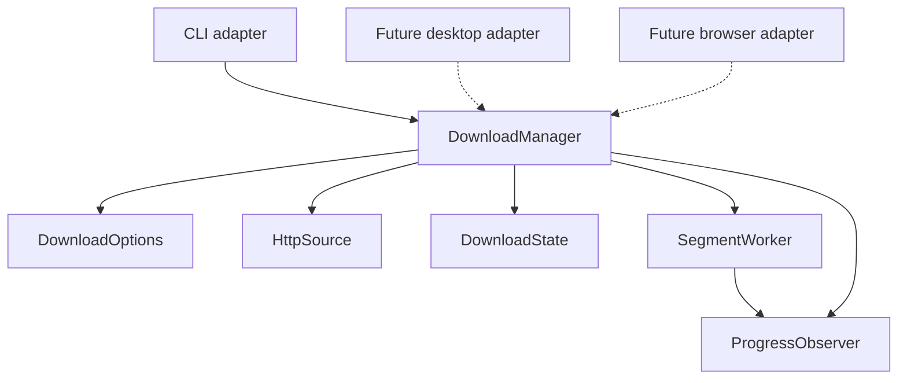

# Architecture

RustIDM uses composition and ownership to separate application logic from its
interfaces. Structs encapsulate state and expose methods; a trait expresses the
progress interface that a CLI, desktop view, or browser adapter can implement.



| Module | Responsibility |
|---|---|
| `domain.rs` | Options, progress/results, resource identity, and range planning |
| `manager.rs` | Application service: validation, transfer orchestration, and completion |
| `http.rs` | HTTP client configuration, probing, and response-header validation |
| `state.rs` | Sidecar manifest, exclusive lock, part paths, assembly, and publication |
| `transfer.rs` | Range workers and single-stream transfer with cancellation/retries |
| `main.rs` | Argument parsing, Ctrl+C, progress rendering, and exit behavior |
| `lib.rs` | Small public API and convenience entry point |

## Public API

`DownloadOptions` has private external fields and builder-style methods.
`DownloadManager` owns its options and composes the concrete HTTP/state services.
`ProgressObserver` is the extension point for presentation; closures implement
it automatically. A cancellation token is shared with active transfers.

```rust,no_run
use rustidm::{CancellationToken, DownloadManager, DownloadOptions, Progress};

# async fn example() -> anyhow::Result<()> {
let options = DownloadOptions::new("https://example.com/archive.zip", "archive.zip")
    .with_connections(4)
    .with_retries(3);
let manager = DownloadManager::new(options);
let result = manager.download(CancellationToken::new(), |progress: Progress| {
    println!("{} bytes", progress.downloaded);
}).await?;
println!("Saved {} bytes", result.bytes);
# Ok(())
# }
```

There is no inheritance hierarchy or separate engine per interface. Transport
and storage traits can be introduced when a second implementation needs them;
the current concrete components are exercised through real HTTP behavior tests.

## Download lifecycle

1. Validate options and acquire the output's writer lock.
2. Probe a one-byte range with identity encoding; inspect size and validator.
3. Create or validate the saved manifest. Parallel/resumed transfers require
   ranges and a strong ETag or Last-Modified validator.
4. Transfer non-overlapping segments into separate files, retrying missing bytes.
   Otherwise download a single stream, restarting that stream on retry.
5. Verify sizes, assemble into a temporary file, sync it, and publish without
   replacing an existing destination.
6. Remove only known sidecar files after successful publication.

Dropping `DownloadState` releases its OS file lock, including on errors. Failed
range transfers retain their data; a subsequent manager validates resource
identity before reuse. Progress callbacks may run concurrently and must be
thread-safe. Interface adapters should enqueue events rather than block workers.

The manifest stores URLs, size, validators, and segment layout. Request headers
are supplied in memory and must be supplied again for authenticated resume.
Static segments and some blocking local file I/O remain deliberate initial
constraints; queueing and performance work belongs to the CLI milestone.
